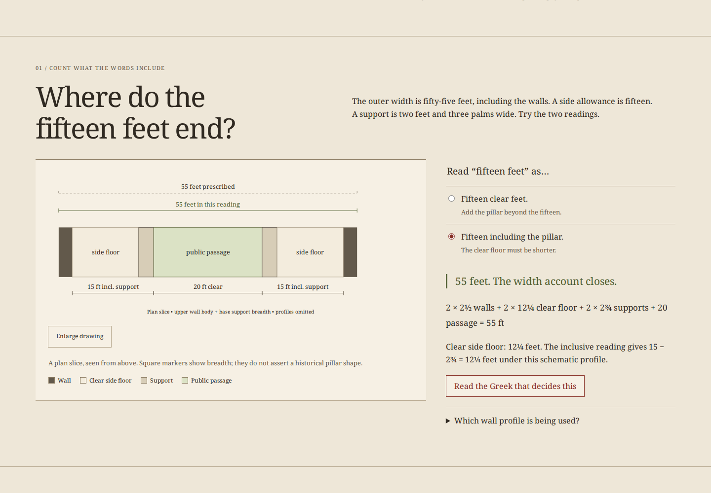

# Syngraphe

**Turn a Greek building specification into a measured drawing.**

A plan can match a total and still contradict the words. The Piraeus naval
storehouse programme gives fifteen feet **including** a pillar, thirty feet
**including** a capital, and seven shaft segments **except** that the first is
longer. Syngraphe lets an English-speaking beginner make those reading decisions,
see their geometric consequences and inspect the printed evidence.

[](https://github.com/antonsoo/syngraphe/actions/workflows/ci.yml)
[](LICENSE)
[Live workshop](https://antonsoo.github.io/syngraphe/)



This is a source-and-constraint workshop, rather than a finished reconstruction.
Eight short Greek readings have new English and twenty-two contextual word
notes. Ten whole pages from Choisy's 1884 edition retain the Greek, his French,
notes and reconstruction plates. Those plates are identified as his
interpretation, separately from the ancient clauses and the modern model.

## Try three decisions

1. **Where do fifteen feet end?** Start with fifteen clear feet plus the support.
   The schematic width is 60½ feet, exceeding the prescribed fifty-five.
   Include the support inside the fifteen: the clear side floor becomes 12¼
   feet and the account closes, under the stated wall/support profile.
2. **Can thirty feet still be wrong?** Give seven four-foot shaft segments a
   two-foot capital. The total matches thirty, but the exceptional first segment
   is wrong. Use one five-foot segment and six four-foot segments; the residual
   capital is one foot. That residual is derived, not separately prescribed.
3. **Does a count finish a plan?** Keep 35 supports in each row over four plethra.
   Choose symmetric end gaps and equal centre spacing. Five-foot and seven-foot
   gaps give different layouts that retain the selected measurements. This
   demonstrates what those selected clauses leave open, without claiming both
   layouts satisfy the full inscription or archaeology.

Select a Greek phrase to see its meaning and geometric job. Jump directly to its
whole source page. Enlarge a drawing or page and pan it with arrow keys. Numbers
also remain ordinary text beside the illustrations.

## Run locally

Node **24 or later**, Git and npm:

```sh
git clone https://github.com/antonsoo/syngraphe.git
cd syngraphe && npm ci
npm run dev
```

Open `http://127.0.0.1:4351/syngraphe/`. This is a new repository; no npm package
release is asserted. `npm run build` writes the production edition to `dist/`;
`npm run preview` serves that edition at the same address after stopping dev.
Offline installation belongs to production, not the Vite development server.

## Keep an experiment

| Artifact         | Contents                                                                                                                                                                       |
| ---------------- | ------------------------------------------------------------------------------------------------------------------------------------------------------------------------------ |
| Editable JSON    | Versioned selected-clause settings; reopen through the file control                                                                                                            |
| Measurement CSV  | Prescribed/derived values and all 35 centre positions, with exact finger fractions and experiment scope on every row                                                           |
| Drawn SVG        | Scalable width, stack and grid study with source and assumption labels                                                                                                         |
| Illustrated HTML | Current experiment, eight complete readings, all word notes, ten source images, local font, full licenses and native JSON/CSV/SVG downloads; no script or remote asset request |
| Browser PDF      | Print the retained HTML; the reviewed example is included below                                                                                                                |

[Actual editable example](examples/plan.json) · [Actual CSV](examples/measurements.csv) ·
[Actual SVG](examples/study.svg) · [Retained HTML, gzip](examples/reading.html.gz) ·
[Actual 23-page PDF](examples/reading.pdf).

```sh
gzip -dc examples/reading.html.gz > /tmp/syngraphe-reading.html
```

Saving captures the settings when the action begins. Source display and
illustrated export verify lengths and SHA-256 values before using page bytes.
An HTTP 200 containing a different page is refused. An installed production
edition works offline only after the current worker controls the page and its
complete inventory is cached; the status reports that state.

## How the model works

The width/height account uses integer **fingers**: four fingers to a palm, four
palms to a foot. Grid positions use reduced fractions. Drawing coordinates are
approximate; account values and exported measurements are exact. The workshop
assigns no modern metre value to the ancient foot.

```text
Greek clause -> chosen reading -> exact account -> drawing
      |                              |
      +-> whole printed page         +-> editable / retained experiment
```

[Model and formulas](docs/model.md) explain the width profile, additive height
account and uniform-grid assumptions. [Sources and transcription](docs/sources.md)
identify the ancient reference, restoration brackets, edition, units and rights.
The long grid is a modern illustration of selected constraints, not an
engineering or archaeological reconstruction.

## Evidence

The independent Python oracle checks both width readings, 130 stack choices,
129 end gaps and 4,515 support positions with `fractions.Fraction`. Its foot-based
formulas independently check the TypeScript's finger-based implementation.

The browser review exercises actual operations, all Greek word notes, source
identities, malformed imports, share links, genuine downloads and script-disabled
native reopening in Chromium and Firefox at desktop and 375 pixels. Native
records and PDF text are audited separately from the model. The retained PDF
contains all sixteen complete Greek/English passages, twenty-two complete word
notes and ten source captions; extracted words stay within the checked margins.

See [the direct review](docs/review.md) for exact observed boundaries, screenshots
and reproducible receipts. Public delivery and remote CI are separate claims.

```sh
npm run check
npm run verify:model
npm run verify:sources
npx playwright install --with-deps chromium firefox
npm run test:browser -- /tmp/syngraphe-review
python3 scripts/artifacts.py /tmp/syngraphe-review
```

Source reproduction and artifact/PDF checks require Python 3 and Poppler. The
source-byte reference renderer is Poppler 24.02.0. The model oracle uses Python's
standard library only.

## Accuracy and limits

- The width uses the upper wall body's 2½ feet with the support's 2¾-foot base
  breadth, omitting changing profiles and taper. Its 12¼-foot clear floor is
  conditional on that simplified account.
- The one-foot capital follows from an additive stack account. Its moulding,
  plan shape and structural behavior are not reconstructed.
- The equal grid, symmetric end gaps and square support markers are modern
  choices. Roof, doors, storage, joints and archaeological constraints are outside
  this model. Passing the selected checks does not verify the complete building.
- New English and word notes have not received independent philological review.
  Choisy's bracketed restorations remain visible. The modern IG transcript is a
  comparison reference, not the bundled edition.
- The PDF is untagged, and physical printer behavior is unverified. SVG text
  uses the viewer's serif font. External reference links require a connection;
  the retained HTML and complete installed edition do not.

## Contributing and license

See [Contributing](CONTRIBUTING.md). Bring a concrete learner improvement or a
source/model correction with evidence. New code, English and diagrams are
[MIT licensed](LICENSE), Copyright (c) 2026 Anton Soloviev. Historical pages are
public domain; Noto Serif uses SIL OFL 1.1. See
[third-party notices](THIRD_PARTY_NOTICES.md).
